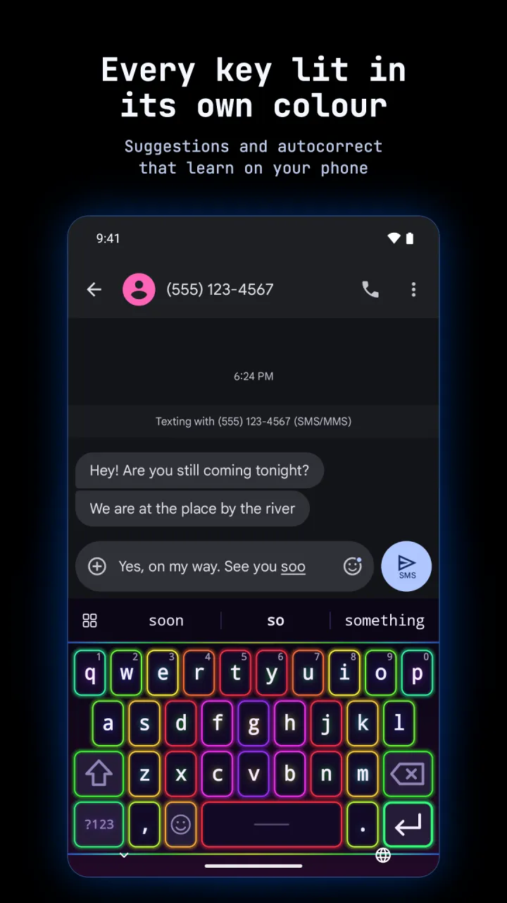

  

<h1 align="center">Keyglow</h1>

A private keyboard for Android with RGB glow, in the colours of your launcher. No internet.

  <a href="https://play.google.com/store/apps/details?id=com.zanoshky.keyglow"><b>Google Play</b></a> ·
  <a href="https://keyglow.zanoski.com"><b>keyglow.zanoski.com</b></a> ·
  <a href="https://zanoshky.github.io/keyglow-keyboard/"><b>User guide</b></a> ·
  <a href="https://github.com/Zanoshky/keyglow-keyboard/issues/new/choose"><b>Report a bug</b></a>

  

This repo is the public home for Keyglow users: the user guide, bug reports and feature requests. The app itself is a paid Android keyboard and its source is not here.

## Quick start

1. Install Keyglow from Google Play. It runs on Android 7 or newer.
2. Open it and tap Turn on Keyglow. Switch it on in Android's list of keyboards.
3. Tap Switch to Keyglow and pick it.
4. Type in the try it field. With Hyprtile or Phosphor as your home screen, the keys already wear your theme.
5. Turn on the languages you write in, then pick the lighting you like.

## The guide

| Page | What is in it |
| --- | --- |
| [Guide](https://zanoshky.github.io/keyglow-keyboard/guide.html) | Everything from A to Z, in order |
| [FAQ](https://zanoshky.github.io/keyglow-keyboard/faq.html) | Answers and fixes for common problems |
| [Report a bug](https://zanoshky.github.io/keyglow-keyboard/report.html) | What to include in a good report |
| [Sources](https://zanoshky.github.io/keyglow-keyboard/sources.html) | The word lists, word pairs and emoji data in the app, each with its licence |

The guide source is plain HTML in [docs](docs).

## Report a bug or ask for a feature

1. Search the [open issues](https://github.com/Zanoshky/keyglow-keyboard/issues) first. If yours is there, add a thumbs up or a comment.
2. Otherwise open a [bug report](https://github.com/Zanoshky/keyglow-keyboard/issues/new?template=bug_report.yml) or a [feature request](https://github.com/Zanoshky/keyglow-keyboard/issues/new?template=feature_request.yml).
3. Add your app version, phone model and Android version, and a screenshot if you can. A keyboard screenshot often shows what you typed, so crop out anything private first: issues are public.

## License

The guide text and images in this repo are shared under [CC BY 4.0](LICENSE). The Keyglow app itself is proprietary and is not covered by this license. The JetBrains Mono font in [docs/fonts](docs/fonts) is under the [SIL Open Font License 1.1](docs/fonts/OFL.txt).
